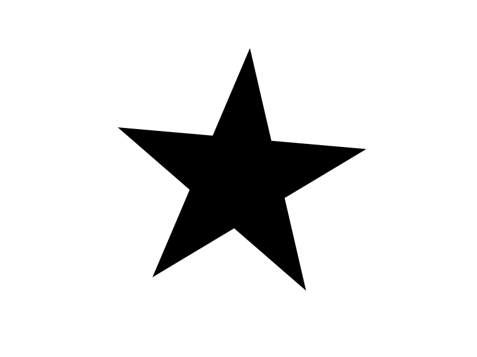
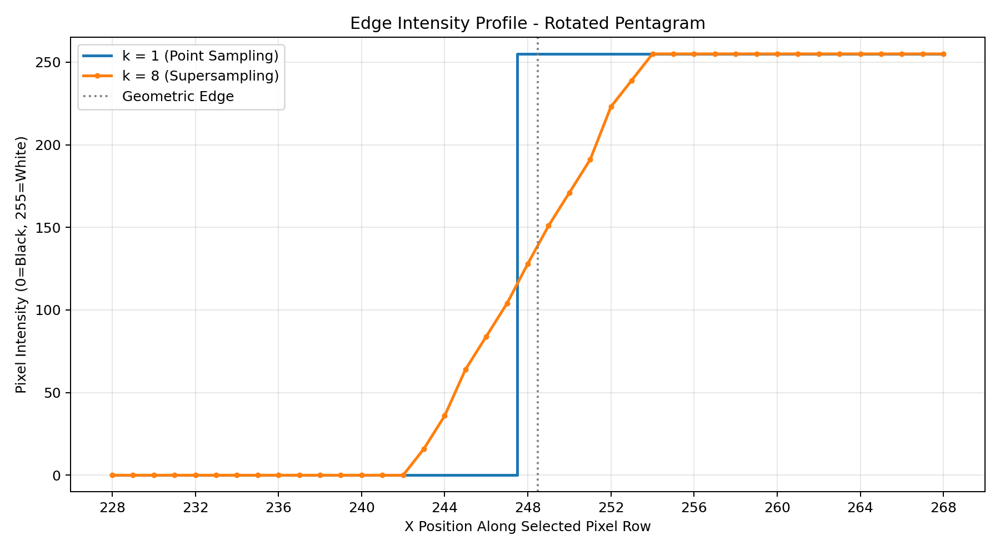
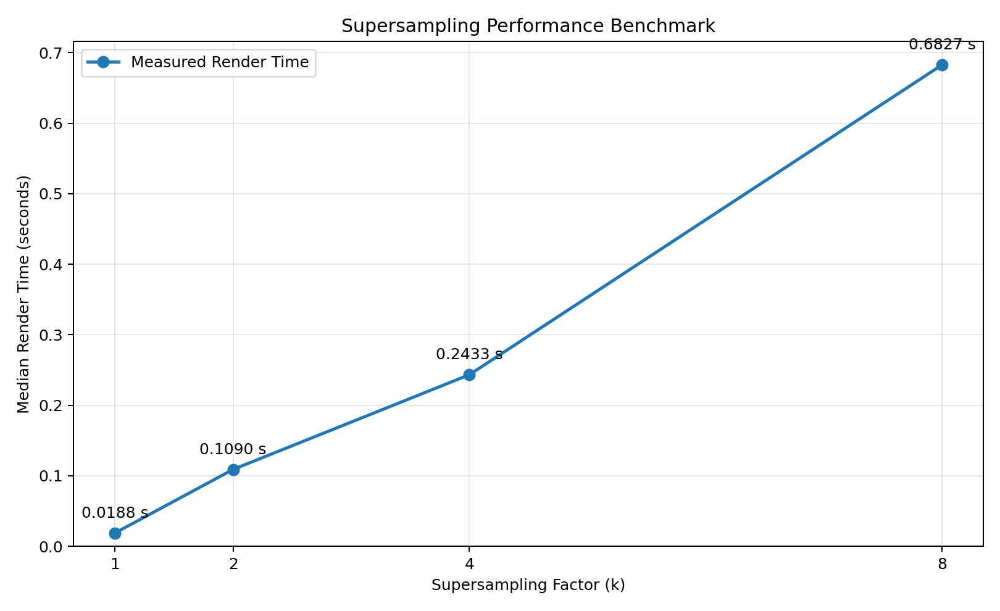
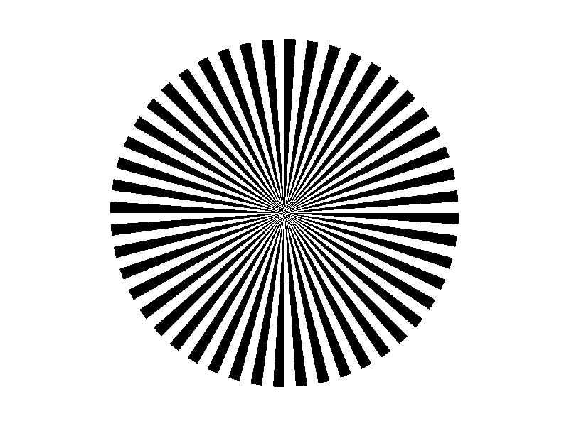
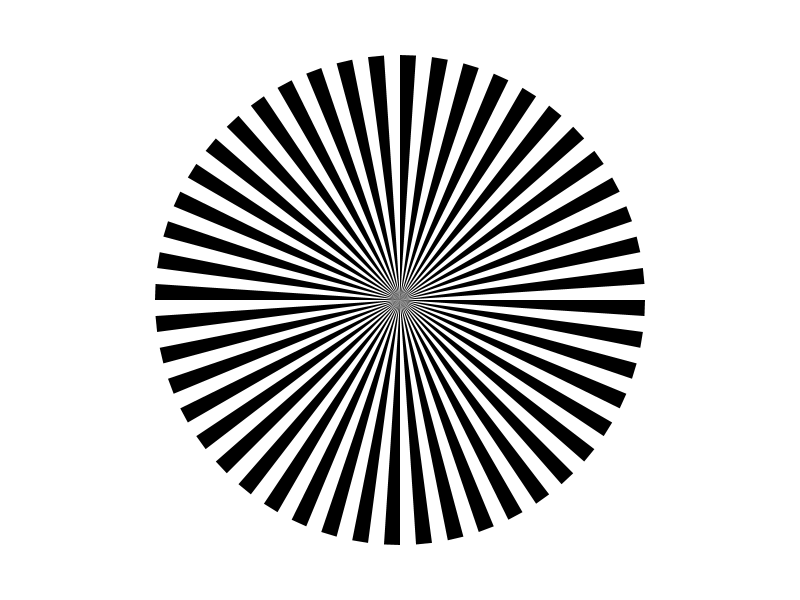
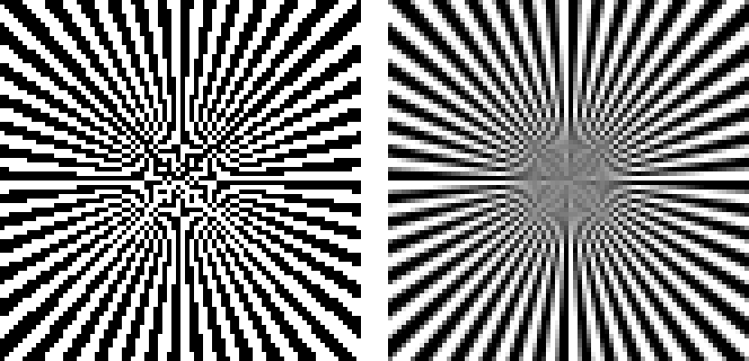

# Landing on the Pixel Grid

**A reproducible Python graphics laboratory for supersampling, area coverage, rasterization, and spatial-frequency aliasing.**

This project explores what happens when continuous geometric shapes are converted into a finite pixel grid. It implements a custom **non-zero winding scanline rasterizer**, builds an **area-coverage approximation through supersampling**, measures the resulting intensity profiles and rendering costs, and investigates **aliasing and moiré-like artifacts** with a high-frequency radial wheel.

The geometry-to-pixel conversion is implemented explicitly in Python and NumPy. Pillow is used for image export and preview; Matplotlib is used only for measurement visualization. No library polygon-fill, path-stroking, or automatic anti-aliasing operation determines shape coverage.

## Contents

- [Highlights](#highlights)
- [Experimental pipeline](#experimental-pipeline)
- [Requirements and installation](#requirements-and-installation)
- [Quick start](#quick-start)
- [Implementation](#implementation)
- [Experiment 1 — Area coverage and supersampling](#experiment-1--area-coverage-and-supersampling)
- [Experiment 2 — Edge intensity and render-time measurements](#experiment-2--edge-intensity-and-render-time-measurements)
- [Experiment 3 — High-frequency wedge wheel](#experiment-3--high-frequency-wedge-wheel)
- [Reproducibility and measurement notes](#reproducibility-and-measurement-notes)
- [Project files](#project-files)
- [Conclusions and limitations](#conclusions-and-limitations)

## Highlights

| Capability | Implementation |
| --- | --- |
| Custom shape coverage | Signed crossings and non-zero winding number |
| Geometry | Five-vertex, self-intersecting pentagram; 2D rotation |
| Anti-aliasing | Supersampling factors **k = 1, 2, 4, 8** |
| Reconstruction | Explicit **k × k box average** into an 800 × 600 output |
| Image analysis | Intensity scan along a shallow-sloped star edge |
| Performance | Three runs per factor; median wall-clock render time |
| High-frequency test | **48** radial triangular wedges with equal-width angular gaps |
| Reproduction | Individual scripts or one-command execution via `run_all.py` |

## Experimental pipeline

```text
Closed geometric subpaths
        |
        v
Scale coordinates by k
        |
        v
Rasterize on an (800k) x (600k) RGB pixel array
   - scanline / edge intersections
   - signed winding accumulation
   - fill spans where winding != 0
        |
        v
Group subpixels into k x k blocks
        |
        v
Average each block to an 800 x 600 image
        |
        +--> PNG images / image comparisons
        +--> intensity-profile CSV and plot
        +--> render-time CSV and plot
```

The final images are **800 × 600 RGB**, regardless of the supersampling factor. Geometry is defined in pixel coordinates with **x increasing rightward** and **y increasing downward**.

## Requirements and installation

Developed and tested on **Windows with Python 3.10.8** in a virtual environment. The recorded environment used:

| Library | Verified version | Role |
| --- | --- | --- |
| NumPy | 2.2.6 | Pixel buffers and subpixel block averaging |
| Pillow | 12.3.0 | PNG loading, saving, and preview |
| Matplotlib | 3.10.9 | Plots of measured quantities |

Python 3.10 or later is recommended; exact performance will vary by operating system, package versions, and hardware.

**Windows PowerShell (from the project folder):**

```powershell
python -m venv .venv
.\.venv\Scripts\Activate.ps1
python -m pip install numpy pillow matplotlib
python run_all.py
```

**macOS / Linux:**

```bash
python3 -m venv .venv
source .venv/bin/activate
python -m pip install numpy pillow matplotlib
python run_all.py
```

You can verify the environment using:

```bash
python -c "import numpy, PIL, matplotlib; print(numpy.__version__, PIL.__version__, matplotlib.__version__)"
```

> `run_all.py` automatically regenerates the experimental outputs in the project directory. Some image scripts call `Image.show()`, so running all experiments on a desktop may open multiple image-preview windows. Matplotlib plots are saved without requiring interactive chart windows in the batch run.

## Quick start

Run **all experiments** in the required dependency order:

```bash
python run_all.py
```

Or run individual investigations:

| Command | Output |
| --- | --- |
| `python main.py` | Rotated star at k = 1, 2, 4, 8 |
| `python benchmark.py` | `experiment_2_render_times.csv` |
| `python plot_benchmark.py` | `experiment_2_render_times.png` (requires the benchmark CSV) |
| `python edge_profile.py` | `experiment_2_edge_profile.csv` and `.png` (requires the star images) |
| `python wheel_experiment.py` | Wheel images at k = 1 and k = 8 |
| `python wheel_center_analysis.py` | Center-detail comparison (requires the wheel images) |

## Implementation

### Scanline rasterization and signed winding

`rasterizer.py` implements the underlying pixel-coverage decision:

1. For each output row, evaluate the horizontal scanline at the **pixel center**: `scan_y = y + 0.5`.
2. Intersect the scanline with every edge of every closed subpath, ignoring horizontal edges.
3. Use a **half-open y interval** (`min(y1,y2) <= scan_y < max(y1,y2)`) to avoid double-counting shared vertices.
4. Sort intersections from left to right and accumulate signed directions. A downward edge is **+1** and an upward edge is **−1** in this coordinate system.
5. Write directly into the RGB array for spans where the running winding number is non-zero.

The fill rule is **non-zero winding**, not alternate-span/even-odd filling. Geometry may contain multiple closed subpaths, including self-intersecting ones.

### Rotation before rasterization

`geometry.py` creates five points on a circle, connects them in visitation order **0 → 2 → 4 → 1 → 3**, and rotates the path by **5°** about `(400, 300)` using the standard 2D rotation:

$$
\begin{aligned}
x' &= c_x + (x-c_x)\cos\theta -(y-c_y)\sin\theta,\\
y' &= c_y + (x-c_x)\sin\theta +(y-c_y)\cos\theta.
\end{aligned}
$$

The **geometric vertices** are rotated before the rasterizer runs; the project does not rotate an already-rendered bitmap to construct the star images. The rotation removes exactly horizontal and vertical star edges in this configuration.

### Coverage approximation through supersampling

`supersampling.py` draws the *same geometry* on a canvas scaled by **k** in both dimensions. Each final output pixel is formed by averaging its corresponding `k × k` high-resolution samples:

$$
I_k(x,y)=\frac{1}{k^2}\sum_{i=0}^{k-1}\sum_{j=0}^{k-1}I_{\mathrm{high}}(kx+i,ky+j).
$$

For black-on-white coverage, the equivalent idealized expression is:

$$
I_k(x,y)\approx255\left(1-\frac{N_{\mathrm{covered}}(x,y)}{k^2}\right),
$$

where `N_covered` is the number of covered subpixel sample centers. The implementation averages RGB values and rounds the result to `uint8`. **Intermediate intensities (1–254)** indicate partially covered output pixels.

## Experiment 1 — Area coverage and supersampling

### Configuration

- Output: **800 × 600** pixels.
- Geometry: **five-vertex self-intersecting pentagram**, rotated **5°** around `(400, 300)`.
- Factors: **k = 1, 2, 4, 8**.
- Renderer: the same non-zero winding scanline fill for every factor.

### Rendered results

| k = 1 — pixel-center coverage | k = 2 — four subpixel samples |
| --- | --- |
|  |  |
| **k = 4 — sixteen subpixel samples** | **k = 8 — sixty-four subpixel samples** |
|  |  |

### Measured coverage

| Factor k | High-resolution canvas | Subsamples per output pixel | Filled high-resolution samples | Partially covered output pixels |
| ---: | ---: | ---: | ---: | ---: |
| 1 | 800 × 600 | 1 | 54,331 | 0 |
| 2 | 1,600 × 1,200 | 4 | 217,330 | 1,011 |
| 4 | 3,200 × 2,400 | 16 | 869,311 | 1,528 |
| 8 | 6,400 × 4,800 | 64 | 3,477,276 | 1,780 |

**Observation.** At k = 1 every pixel is black or white, and diagonal boundaries show staircase artifacts. At higher k, samples near the boundary are averaged into gray pixels; the edges become visually smoother. The number of intermediate-gray pixels is a *coverage diagnostic*, not an objective measure of image accuracy.

## Experiment 2 — Edge intensity and render-time measurements

### A. Intensity along a shallow-sloped edge

`edge_profile.py` selects the star edge with the smallest absolute slope, chooses a row **near one endpoint**, and measures intensities *along that horizontal pixel row*. Limiting the x range isolates the chosen edge from other star intersections.

Measured geometry and sampling configuration:

| Quantity | Value |
| --- | ---: |
| Shallowest edge index (zero-based) | 2 |
| Edge slope | 0.087489 |
| Sampled image row | y = 218 |
| Geometric edge crossing | x = 248.477 |
| Sampled horizontal positions | x = 228–268 (41 pixels) |
| Intermediate-gray entries, k = 8 | 11 |



[Raw edge-intensity measurements (CSV)](./experiment_2_edge_profile.csv)

**Observation.** With k = 1 the intensity along the selected row jumps directly from 0 (black) to 255 (white). With k = 8 it changes through several intermediate levels over approximately eleven pixel positions. Because the edge is shallow and the row runs along it near an endpoint, the two sampling methods produce visibly different **profile shapes**; a perpendicular cross-section would show a much narrower transition.

### B. Rendering performance

`benchmark.py` measures the complete supersampled rendering pipeline using `time.perf_counter()`: high-resolution allocation, geometry scaling, scanline fill, and block averaging. Each k is run **three times** at the same **800 × 600 final output size**, and the median is reported. Saving the PNG and opening its preview are **not included** in these timing measurements.

| Factor k | Total high-resolution sample positions | Median time (seconds) |
| ---: | ---: | ---: |
| 1 | 480,000 | 0.018802 |
| 2 | 1,920,000 | 0.108994 |
| 4 | 7,680,000 | 0.243291 |
| 8 | 30,720,000 | 0.682740 |



[Raw benchmark runs (CSV)](./experiment_2_render_times.csv)

The number of high-resolution samples grows with **k²**. The measured k = 8 median is approximately **36.3×** the k = 1 median in this run, while the nominal sample count increases by **64×**. Runtime need not follow k² exactly: it also reflects fixed overhead, scanline intersection processing, NumPy's implementation, memory allocation, CPU/cache behavior, and system load. These numbers are observations for this run, not universal timing guarantees.

## Experiment 3 — High-frequency wedge wheel

### Geometry

`wheel_experiment.py` creates **48 independent triangular subpaths** radiating from `(400, 300)` to an outer radius of **245 px**. Each 7.5° angular period is divided equally:

- **3.75°** occupied by a black wedge;
- **3.75°** left as an empty gap.

Every wedge uses the center point and two outer vertices. The same geometry is rasterized at k = 1 and k = 8; all shapes are filled by the custom scanline implementation.

### Full-wheel comparison

| k = 1 — aliasing near the center | k = 8 — area-averaged result |
| --- | --- |
|  |  |

| Quantity | k = 1 | k = 8 |
| --- | ---: | ---: |
| Filled high-resolution samples | 94,376 | 6,031,227 |
| Partially covered output pixels | 0 | 24,880 |
| Partially covered pixels in the central 80 × 80 crop | 0 | 3,792 |

### Central crop: 5× nearest-neighbor display



*Left: k = 1. Right: k = 8. The 80 × 80 center crops are enlarged by exactly 5× using pixel replication (`np.repeat`), without introducing extra smoothing.*

### Why the center breaks down

At k = 1, the center exhibits **aliasing**, including **moiré-like false structures**, not just jagged outer edges. At k = 8, the false high-contrast structure is attenuated and the center approaches a blended gray appearance, but the original alternating spokes do not remain separately identifiable at the final resolution.

For N = 48 wedge/gap periods, the approximate tangential spatial period at radius r is:

$$
T(r)=\frac{2\pi r}{N}, \qquad f(r)=\frac{N}{2\pi r}.
$$

Moving toward the center decreases `T(r)` and increases spatial frequency `f(r)`. For a final output grid sampled once per pixel, the idealized Nyquist requirement is **at least two samples per black/white period**. A local estimate gives the critical radius:

$$
r\approx\frac{N}{\pi}\approx15.3\text{ pixels} \qquad (N=48).
$$

This is an **approximate local tangential criterion**, not a sharp radius beyond which artifacts suddenly disappear. Sampling orientation, phase, finite pixel aperture, and other frequencies also matter.

### Filtering: what averaging can and cannot do

The `k × k` average is a discrete **box filter**, a basic **low-pass prefilter** applied to the high-resolution coverage samples *before reduction* to the final image. It attenuates rapidly varying black/white patterns so they are less likely to appear as misleading lower-frequency structures after downsampling.

However, the box filter is not an ideal band-limited reconstruction filter, and finite-k sampling still approximates area coverage. **Suppressing unresolved detail is not the same as recovering it**: the final 800 × 600 pixel grid cannot preserve arbitrarily fine spokes at the center.

## Reproducibility and measurement notes

- All shape coverage decisions use the project's own scanline rasterization code; `PIL.Image` is used for PNG I/O, not geometry drawing.
- Each factor operates on the same original geometry and yields the same **800 × 600** final image size.
- Every edge-intensity value is read from an exported PNG. The analysis outputs a **41-row CSV** for direct inspection.
- Render times are the **median of three runs**, measured without image display or file-writing time. Rerunning the benchmark overwrites the CSV with new machine-dependent timings; regenerate the chart afterward.
- High supersampling factors need more memory: the k = 8 high-resolution RGB array alone contains 30,720,000 RGB pixels (92,160,000 bytes), before intermediate arrays.
- Very small discrepancies at geometric boundaries can arise from floating-point arithmetic and rasterization edge conventions. They should be treated separately from substantive differences in image quality.

## Project files

```text
Landing-on-the-Pixel-Grid/
├── README.md
├── geometry.py                  # Pentagram coordinates and rotation
├── rasterizer.py                # Non-zero winding scanline coverage
├── supersampling.py             # High-resolution fill and block averaging
├── main.py                      # Rotated pentagram, k=1/2/4/8
├── benchmark.py                 # Render-time measurements -> CSV
├── plot_benchmark.py            # Render-time CSV -> chart
├── edge_profile.py              # Shallow-edge intensity -> CSV + chart
├── wheel_experiment.py          # 48-wedge wheel, k=1/8
├── wheel_center_analysis.py     # Nearest-neighbor central crop comparison
├── run_all.py                   # Execute the full pipeline in order
├── experiment_1_star_k1.png
├── experiment_1_star_k2.png
├── experiment_1_star_k4.png
├── experiment_1_star_k8.png
├── experiment_2_edge_profile.csv
├── experiment_2_edge_profile.png
├── experiment_2_render_times.csv
├── experiment_2_render_times.png
├── experiment_3_wheel_k1.png
├── experiment_3_wheel_k8.png
└── experiment_3_wheel_center_comparison.png
```

## Conclusions and limitations

1. **Supersampling approximates area coverage.** Increasing k produces fractional coverage values and smoother polygon boundaries without delegating coverage decisions to a graphics library.
2. **Image quality comes at a computational cost.** High-resolution storage, rasterization, and averaging grow with the sampling factor; the observed time depends on implementation and hardware.
3. **A shallow-edge intensity profile makes the transition measurable.** k = 1 yields a binary step, while k = 8 generates intermediate intensities across the selected row.
4. **Aliasing is not limited to staircase boundaries.** The wheel's central pattern creates false structure at insufficient sampling rates.
5. **Low-pass filtering avoids misleading detail; it cannot reconstruct missing resolution.** A finite box filter reduces high-frequency artifacts but is not a perfect antialiasing filter.

**Scope.** This is a deliberately transparent CPU-based research implementation rather than a production GPU renderer. It uses fixed-rate supersampling, finite subpixel centers, a box reconstruction filter, and direct averaging of 8-bit RGB values (not linear-light color processing). Potential extensions include adaptive sampling, better reconstruction filters, gamma-aware averaging, automated image-difference metrics, and an interactive view of sampling locations.
